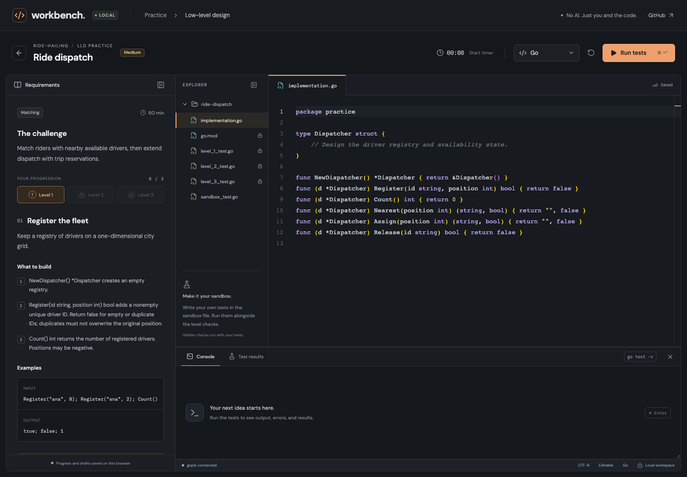

# Workbench

A local low-level design practice app inspired by the test-taking layout of CodeSignal. Monaco, real language servers, collapsible requirements, progressive exercises, and test output. No AI autocomplete or AI service integrations.



## Run locally

Requirements: **Node.js 24+**, **Go 1.22+**, and **Python 3.10+**. Go is the default language; Python and TypeScript are available for every exercise.

```sh
npm install
go install golang.org/x/tools/gopls@latest
npm run dev
```

Open [127.0.0.1:5173](http://127.0.0.1:5173). Ensure `$(go env GOPATH)/bin` is on your `PATH` before starting the app. Pyright and the TypeScript language server are installed by npm. The editor, workers, and fonts are bundled locally; practice needs no network after installation.

For a production build:

```sh
npm run build
npm start
```

Open [127.0.0.1:4173](http://127.0.0.1:4173). Both modes also start the API on port 3001 and bind to the loopback interface.

## Practice

- Choose an exercise from the **workbench.** logo or back arrow. Filter by ride-hailing, banking, or fundamentals.
- Open **Practice roadmap** for a recommended order, language-specific progress, and a shortcut to the next unfinished exercise. Start with the stack and queue, use vending machine as the medium bridge, then dependency planner as the hard bridge. The roadmap is also available at `/#roadmap` and from the exercise library.
- Implement the current level in `implementation.go`, `implementation.py`, or `implementation.ts`.
- Use normal language completions, hover information, signatures, definitions, and diagnostics from gopls, Pyright, or the TypeScript language server. Inline AI suggestions are disabled.
- Use **+ New file** in Explorer to create additional `.go`, `.py`, or `.ts` source files, including paths such as `helpers/pricing.go`. Switch files in Explorer; extra files are saved with the selected exercise and language.
- Add personal tests to the sandbox or create your own test files: `*_test.go`, `test_*.py` / `*_test.py`, or `*.test.ts` / `*_test.ts`. Nested test files run too. Supplied tests are read only; Go test names do not need a special prefix.
- Click **Run tests** or press **⌘ Enter / Ctrl Enter**. The console shows the actual runner output, including your test logs, errors, assertion failures, and hidden check results.
- Passing the cumulative checks unlocks the next level. Later-level test files are excluded from the execution snapshot until their level is selected.
- Drag the dividers to resize requirements, the file explorer, and the console. Each pane can be collapsed and restored; sizes and visibility are remembered in this browser. Focus a divider and use arrow keys to resize (Shift for larger steps), or double-click it to reset the size. Run tests automatically reopens a collapsed console. The practice timer is optional and can be paused.

Use the expand icon next to the language selector to enter **focus mode**. It hides the branding bar and shrinks the toolbar while keeping the language selector and Run tests available. The same button exits focus mode; this preference is remembered too.

Drafts and unlocked levels are saved in browser local storage separately for each exercise and language. Runtime workspace files live under ignored `.practice/workspaces/`. Reset affects only the selected exercise and language. Browser data clearing removes drafts and progress.

The prompts use Go-style contracts as a common specification. Python and TypeScript starters retain PascalCase method and constructor factory names; follow their supplied type signatures and tests for return representations.

## Exercises

All 26 exercises have three progressive levels and starters/tests for all three languages, including visible examples, hidden edge checks, and an editable sandbox. Eight easy exercises provide a gradual ramp before the medium and hard bridges on the roadmap.

| Domain       | Exercises                                                                                                                                                                                                                              |
| ------------ | -------------------------------------------------------------------------------------------------------------------------------------------------------------------------------------------------------------------------------------- |
| Ride-hailing | Ride dispatch, Fare calculator, Trip lifecycle, Driver availability, Parking lot, Multi-level parking garage, Seat booking, Parcel locker                                                                                              |
| Banking      | Wallet ledger, Account transfers, Card limits, Transaction history                                                                                                                                                                     |
| Fundamentals | Bounded stack, FIFO queue, Score tracker, Contact directory, Shopping cart, Thermostat, Vending machine, Library lending, In-memory filesystem, Inventory reservations, LRU cache, Rate limiter, Dependency planner, Delayed job queue |

These are original practice scenarios covering common Uber-like and Nubank-like domains. They are not official interview questions from either company.

## Test execution

Native execution is the default. Each run uses a temporary snapshot, captures stdout/stderr, enforces a time/output limit, and cleans up afterward. It executes code with your local account's permissions; this is a personal practice tool for code you trust, not a hosted judge for untrusted submissions.

| Language   | Runner                                                             |
| ---------- | ------------------------------------------------------------------ |
| Go         | `go test -v -count=1 -timeout=12s ./...`                           |
| Python     | Python unittest with selected level checks and all user test files |
| TypeScript | Node 24 native type stripping with `node --test`                   |

The TypeScript runner executes TypeScript without an intermediate compile step. Its language server provides type diagnostics; test execution itself does not type-check. Use type-strippable syntax in solutions (avoid enums and constructor parameter properties).

Hidden test source is omitted from the editor and exercise metadata API. This public repository includes the test definitions, so “hidden” means concealed during practice, not an anti-cheating security boundary.

### Docker option

With a running Docker-compatible daemon, pre-pull the language images:

```sh
docker pull golang:1.26-alpine
docker pull python:3.14-alpine
docker pull node:24-alpine
PRACTICE_DOCKER_CONTEXT=orbstack PRACTICE_RUNNER=docker npm run dev
```

Set `PRACTICE_DOCKER_CONTEXT` to your Docker context name, or omit it to use your normal Docker connection. An explicit context is useful when `DOCKER_HOST` still points to another engine.

Docker runs use a read-only workspace and root filesystem, a writable temporary filesystem, no network, CPU/memory/process limits, dropped capabilities, and a timeout. Language servers still run locally. Container images must be available before starting a run. A missing daemon or image is reported in the console; Docker mode does not silently fall back to native execution.

## Development

```sh
npm test                 # catalog and runner/API checks
npm run build            # TypeScript checking and production bundle
npx playwright install chromium
npm run test:e2e         # real browser workspace checks
npm run test:lsp         # installed language-server checks
PRACTICE_DOCKER_CONTEXT=orbstack npm run test:docker # real container checks
```

`shared/` contains the exercise catalog, portable starter/test generation, and recommended roadmap. `server/` owns workspace storage, the JSON-RPC language-server bridge, and test runners. `src/` contains the React interface and Monaco integration. New case modules keep Go prompts/starters/tests alongside their Python/TypeScript API and test commands; register their exports in `shared/problems.ts` and `shared/languages.ts`, and add their recommended position to `shared/roadmap.ts`.
